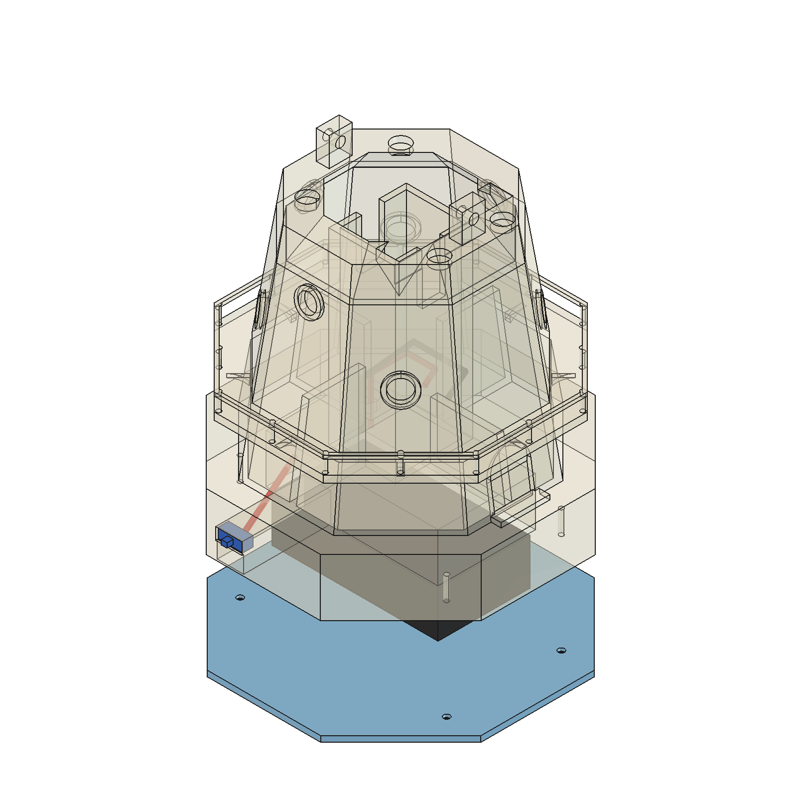
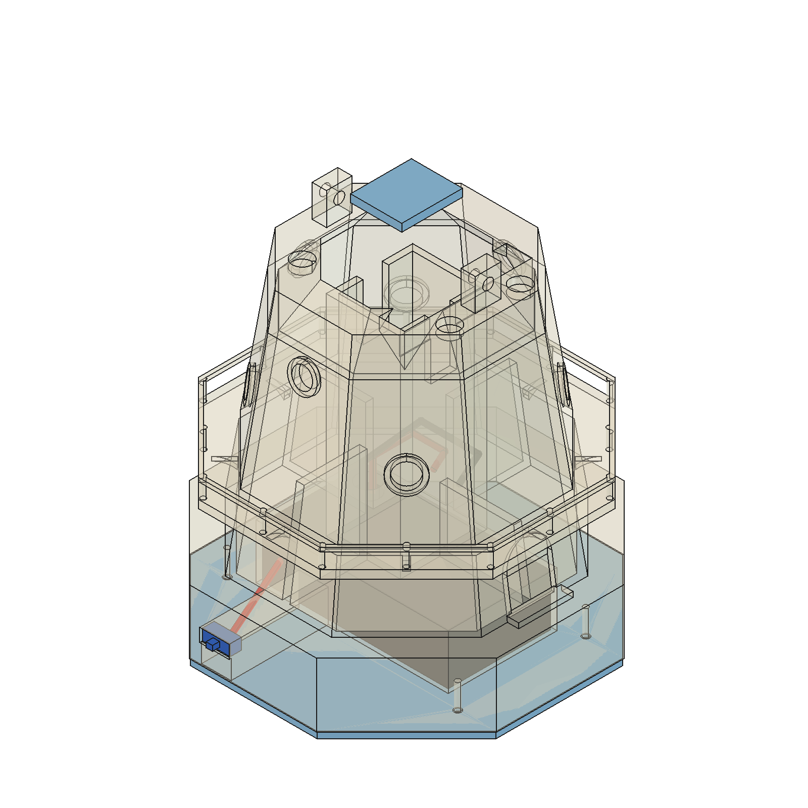
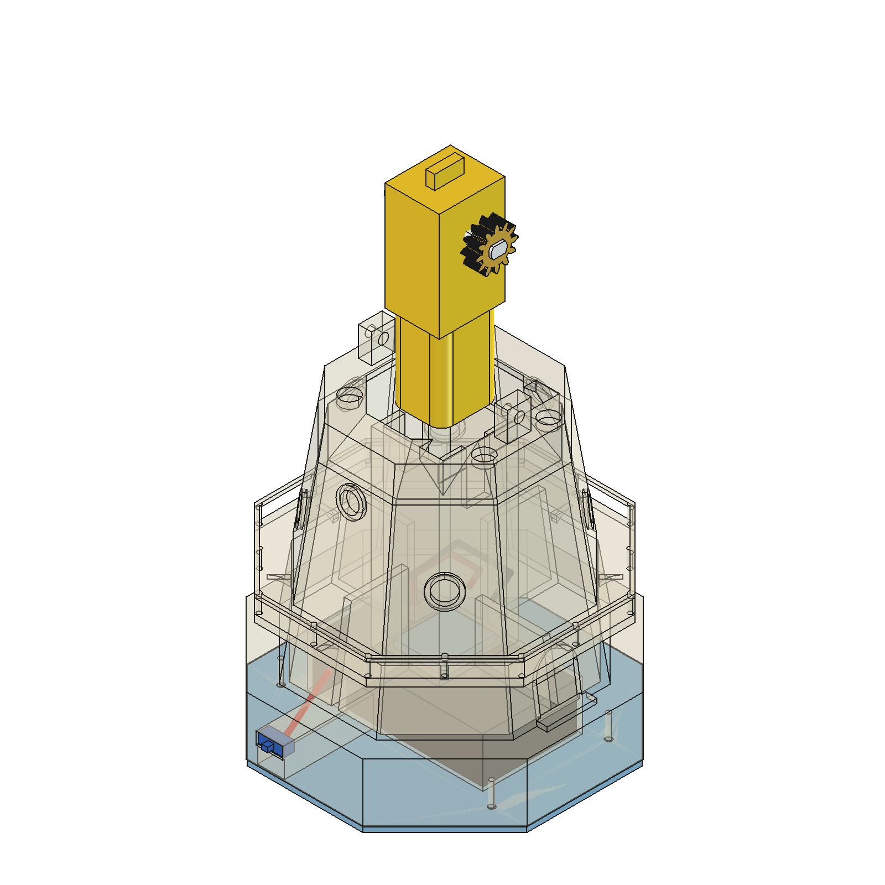
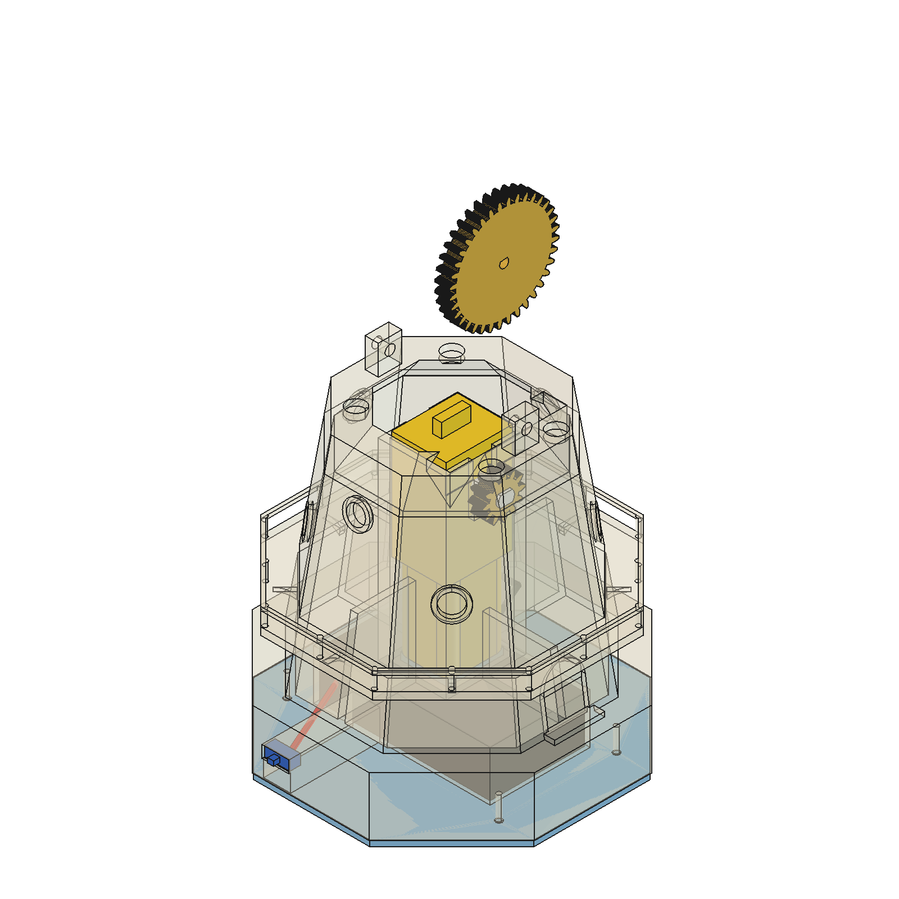
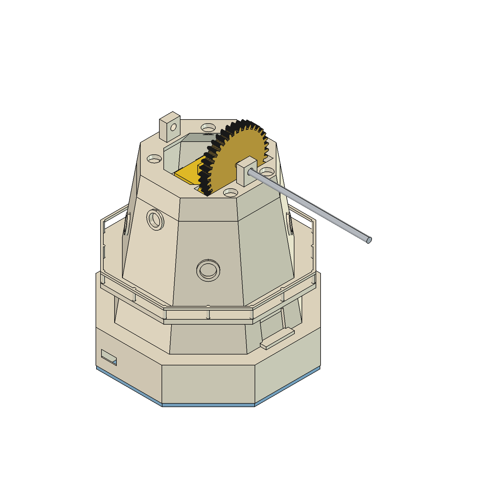
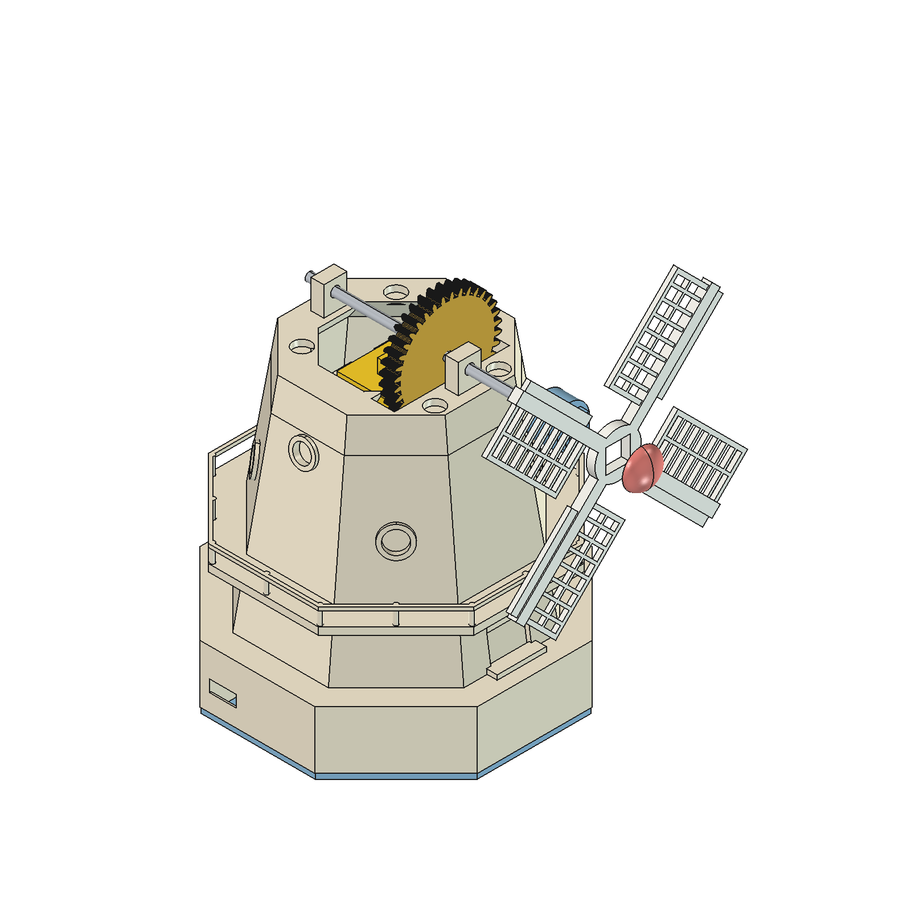
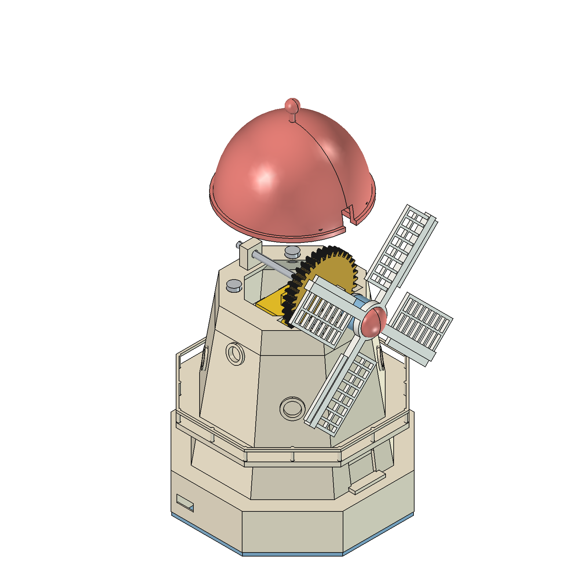
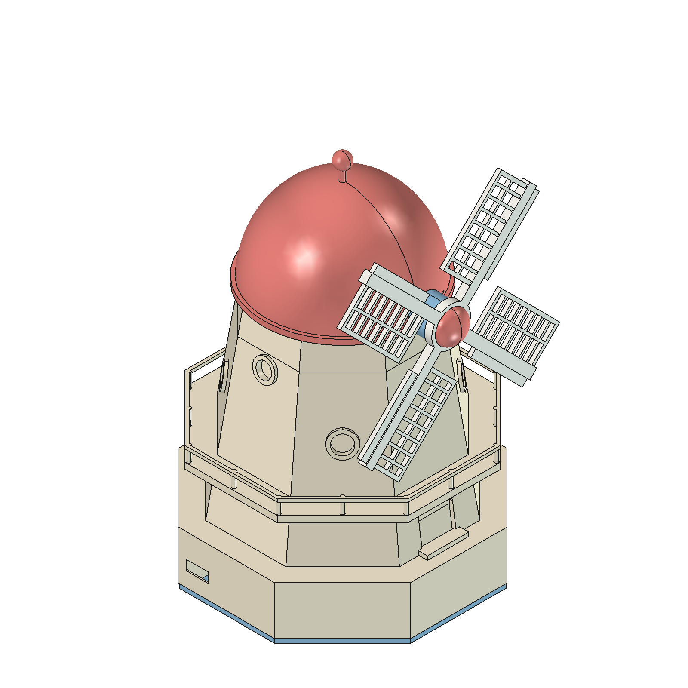

# Build guide

About an hour of building once everything is printed. You need: a small Phillips screwdriver, a small file, super glue
(CA), and a ruler or calipers.

## 0. Print everything (in this order)

1. **Fit test plate:** `Pinion_12T` and `Hub` (0.12 mm layers, 4 walls). When they're done:
   - push the pinion onto the TT motor's output shaft (either side). It should need a firm push and then not wobble.
   - slide the hub onto the 3 mm rod. It should slide with light friction.
   - Too tight: drill or file the hole lightly. Too loose: a drop of CA when you assemble is fine.
2. **Small parts plate:** `Wheel_36T`, `Spinner` (flat back down), all four `Shim_*` files, `Lid`. No supports.
3. **Sails:** `Sails_lattice` (and `Sails_solid` for the second set). Flat, no supports, use a brim.
4. **Cap:** open side down, tree supports inside the dome.
5. **Body:** upright, supports from the build plate only (they hold up the balcony). This is the long print.

Clean the supports off the balcony underside and out of the dome. Check the two little holes in the bearing posts at
the top of the tower are clear: the 3 mm rod should slide through both.

## 1. Battery, switch and lid



1. Turn the base over. The switch slot opens into the battery bay: push the slide switch in from below so the lever
   pokes out of the window in the side. A drop of CA holds it.
2. Wire it (see [Wiring](#wiring) below): battery red to the switch middle pin, one switch side pin to a red wire
   that goes to the motor, battery black straight to the motor.
3. Feed the two motor wires up through the hole in the floor into the tower. Leave about 8 cm sticking up.
4. Put the battery holder in the bay, batteries facing down, and screw the lid on with 4 × M2 × 8.

## 2. Pick and drop in the motor shim



The motor's shaft height sets how tightly the gears mesh, and TT motors vary a little. Measure yours:

- Measure from the **centre of the output shaft** to the **end of the motor can** (the round silver end, not the
  yellow gearbox). Call it **d**.
- Your shim is **2.4 + (25.4 − d)** mm. Use the closest one:

| d (mm) | Shim |
|---|---|
| 26.0 or more | 1.4 mm |
| 25.0 – 26.0 | 2.4 mm (most motors) |
| 24.0 – 25.0 | 3.4 mm |
| under 24.0 | 4.4 mm |

Drop the shim flat into the bottom of the motor channel (the rectangular pocket in the middle of the tower).

## 3. Motor and small gear



1. Push the 12-tooth pinion onto the motor's output shaft on the side **facing the front** (the side with the door),
   pressed all the way to the shoulder.
2. Solder or twist the two wires from step 1 onto the motor's terminals.
3. Lower the motor straight down into the channel, can first, shaft front-to-back, until it sits on the shim. The
   shafts slide down the slots in the channel walls.

## 4. Big gear



Lower the 36-tooth wheel straight down through the slot in the top ring, in front of the motor, with its small boss
facing the back. Its hole lines up with the two holes in the bearing posts. The teeth should rest in the pinion.

## 5. Windshaft rod



1. Cut the rod to 72 mm and file a flat along one side, about 0.5 mm deep, over the whole length. The gear and hub have a D-shaped
   hole that grips this flat, so they can't slip.
2. From the front, slide the rod through the front bearing post, through the wheel (flat lined up with the flat in the
   hole), and out through the rear post.
3. Push it back until about 17 mm sticks out in front of the front post.

**Test now:** turn the rod by hand. It should turn the motor smoothly with a tiny bit of play.
- Grinds or sticks: take the motor out and use the next **thinner** shim.
- Clicks or the gears skip: use the next **thicker** shim.

## 6. Hub and sails



1. Slide the hub onto the front of the rod, flat to flat, until you can just see the rod tip at the bottom of the
   magnet pocket in the hub's front face. A drop of CA on the rod keeps it there.
2. Stick two magnets together, mark the outward face of one, and press the marked one into the hub pocket (marked face
   out) and its partner into the pocket on the back of the spinner, so they attract.
3. Push the sail cross onto the square key on the hub, then snap the coral spinner on. Its rim clamps the cross onto
   the hub. To swap sails, pull the spinner off and slide the cross off.

## 7. Cap magnets and cap



1. **Polarity first:** stick the magnets together in pairs. Keep each pair together and mark the outward face of one
   magnet with a marker.
2. Press one magnet of each pair into the four pockets on top of the tower's top ring, marked face up, with a drop of CA.
3. Press its partner into the matching pocket under the cap, so each pair attracts. The pattern is uneven on purpose:
   the cap only fits one way round, with the notches over the rod.
4. Set the cap on. It should snap down and sit flat.



## Wiring

```
 2xAA holder (+) red ──── switch middle pin
                          switch side pin ──── red ──── motor terminal 1
 2xAA holder (−) black ──────────────────────────────── motor terminal 2
```

Slide the switch on. Real Dutch windmills turn **anticlockwise** seen from the front. If yours turns the other way, swap
the two wires on the motor.

## Troubleshooting

| Problem | Fix |
|---|---|
| Sails don't turn, motor hums | Gears too tight: use a thinner shim (step 2) |
| Gears click or skip | Gears too loose: use a thicker shim |
| Sails wobble or slide off | The spinner magnet is the wrong way round (flip it), or the rod flat isn't lined up with the hub's flat |
| Cap won't sit flat | A magnet sits proud: press it fully into its pocket. The cap only fits one way round |
| Nothing happens | Check the switch wiring and that the batteries face the right way in the holder |
