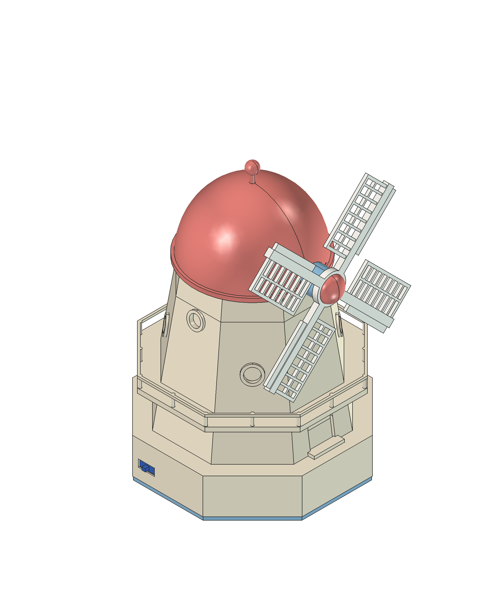
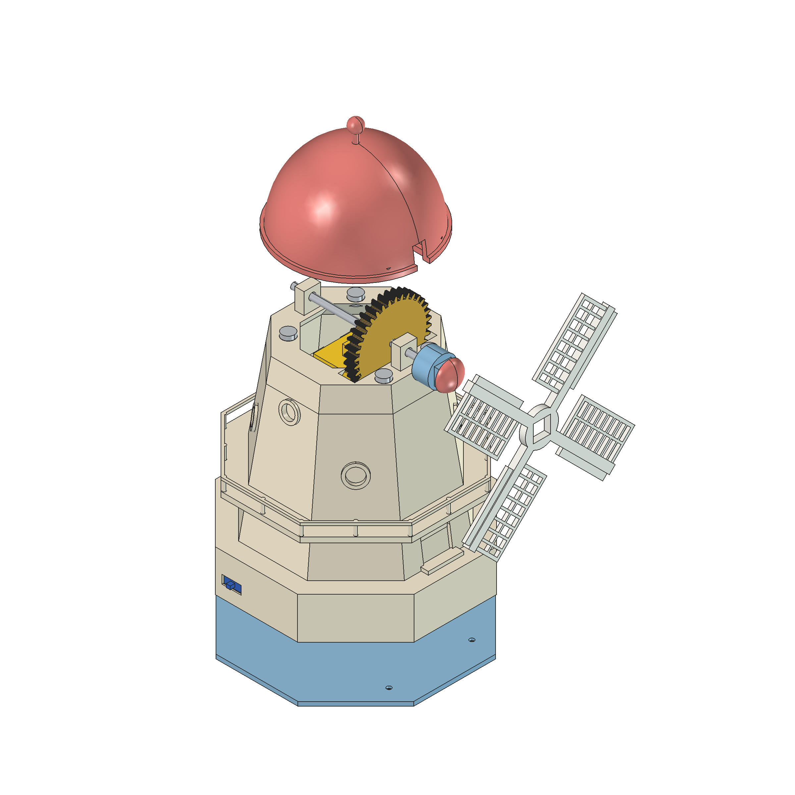
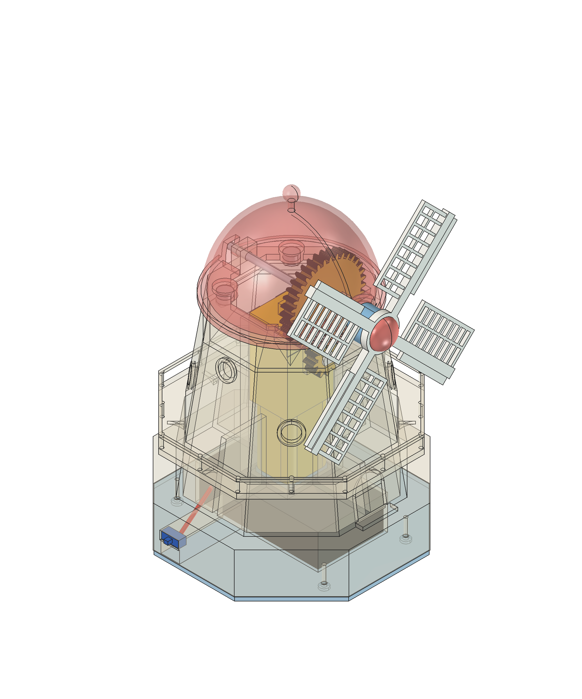
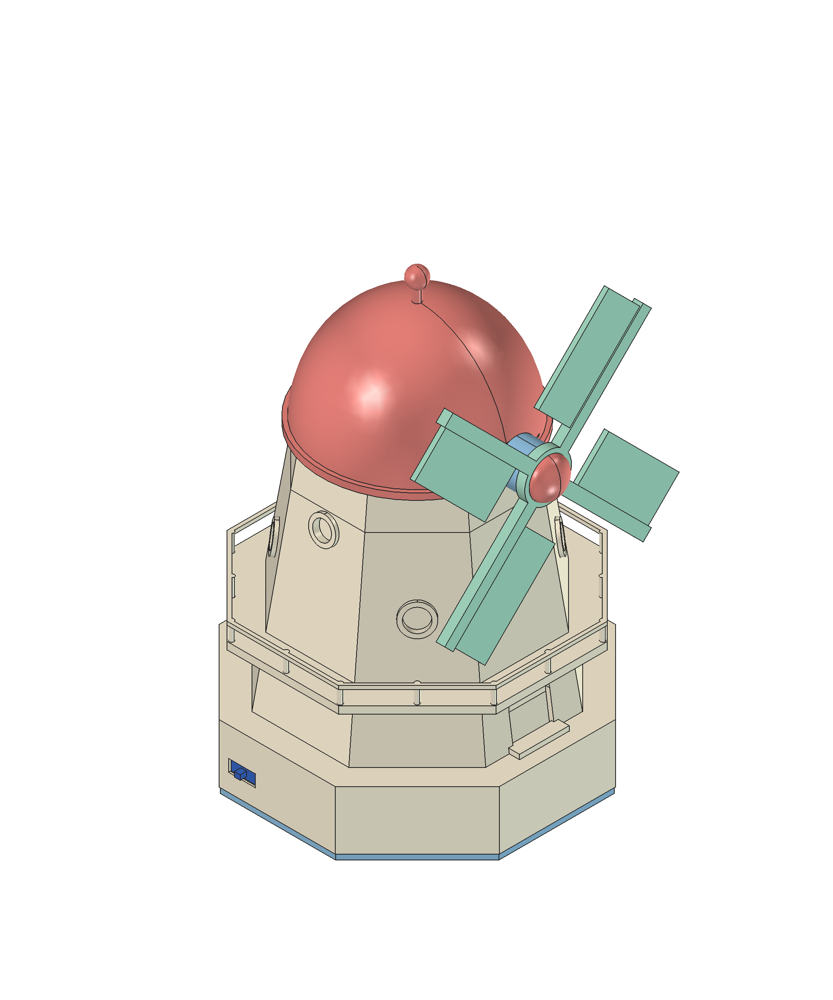

# Cute motorized windmill

A little Dutch windmill that turns its own sails. One yellow TT gear motor and two AA batteries spin the sails at a
calm 30–40 RPM through a printed 3:1 gear pair. It fits inside 4 × 4 × 6 in (101.6 × 101.6 × 152.4 mm) with the sails
turning, and it prints on any printer with a 100 mm bed or larger.

| Pull it apart | See inside | Swap the sails |
|---|---|---|
|  |  |  |

**Build it:** follow [ASSEMBLY.md](ASSEMBLY.md). It has the print order, what to buy, and every step with a picture.

## The two design ideas

- **Merge Surfaces:** the base, tower, balcony and railing, the top ring, both windshaft supports and the motor
  channel are a single print (`Body_merged.stl`). The floor rises straight into the tower, like the Land Peel mat that
  folds up into furniture. There are no brackets or screws inside the tower.
- **Divide Continuous Surface:** the dome cap lifts off on magnets to get at the motor and gears; the magnetic
  spinner pops off so the sail cross pulls off the hub and swaps between a lattice set and a solid set; the bottom lid opens for the batteries.

## What you need

| Qty | Part | Notes |
|---|---|---|
| 1 | TT gear motor 1:48, 3–6 V (the yellow "Arduino car" motor) | |
| 1 | 2 × AA battery holder with leads, plus 2 AA batteries | bay fits up to 59 × 33 × 17 mm |
| 1 | SS-12F15 mini slide switch | |
| 1 | 3 mm steel rod, at least 75 mm long, cut to 72 mm (windshaft) | an M3 screw with the head cut off also works |
| 10 | 6 × 2 mm disc magnets | 8 for the cap, 2 for the hub and spinner that hold the sails on |
| 4 | M2 × 8 self-tapping screws | battery lid |
| | Hookup wire, a drop of super glue (CA), a small file | |

## Printed parts and print order

Print them in this order. The first plate is a 15-minute fit test, so you find a tight hole before you spend most of a
day on the tower.

| Order | Plate | Files | Settings |
|---|---|---|---|
| 1 | **Fit test** | `Pinion_12T`, `Hub` | gears: 0.12 mm layers, 4 walls. Check the pinion pushes onto the motor shaft and the hub slides on the rod |
| 2 | **Small parts** | `Wheel_36T`, `Spinner`, `Shim_1.4mm`, `Shim_2.4mm`, `Shim_3.4mm`, `Shim_4.4mm`, `Lid` | flat on the bed (spinner on its flat back), no supports |
| 3 | **Sails** | `Sails_lattice` (and `Sails_solid` if you want the second set) | flat, no supports, 0.2 mm layers, a brim helps the thin lattice stick |
| 4 | **Cap** | `Cap` | brim (open side) down, tree supports inside the dome only; they come out through the bottom |
| 5 | **Body** (the long one) | `Body_merged` | upright, supports from the build plate only (for the balcony underside); nothing inside the tower needs support |

Everything is PLA at 0.2 mm layers, 3 walls, 15 % infill unless the table says otherwise. Nothing here carries real
load, so normal settings are fine.

## Files

| Path | What it is |
|---|---|
| `stl/` | the 13 files to print |
| `Windmill.FCStd` | the FreeCAD model (open in FreeCAD 1.0 or newer) |
| `windmill.py` | the script that builds the model; every dimension is a parameter at the top |
| `windmill_results.json` | every check the model passes, each with its value and limit |
| `images/` | views of the model and the assembly steps |
| `history/` | earlier versions of the design |

To rebuild after changing a number: `freecadcmd windmill.py` (about 10 minutes, it reruns every check).

## What the checks cover

Size with the sails turning (97.1 × 97.0 × 150.5 mm); every printed part is one clean solid; no part touches another;
at least 1 mm running clearance for the gears, hub and sails; the two gears turned through a full tooth with no overlap
and 0.12 mm play; the motor, big gear and rod each go in along their assembly path without hitting anything; the shim
set covers 1 mm low to 2 mm high on the motor; torque margin about 11× at 3 V; no overhangs inside the tower.

It has been checked in the model only. Nothing has been printed or run yet.

## License

[CC BY 4.0](LICENSE): use, change and share it, with credit.
